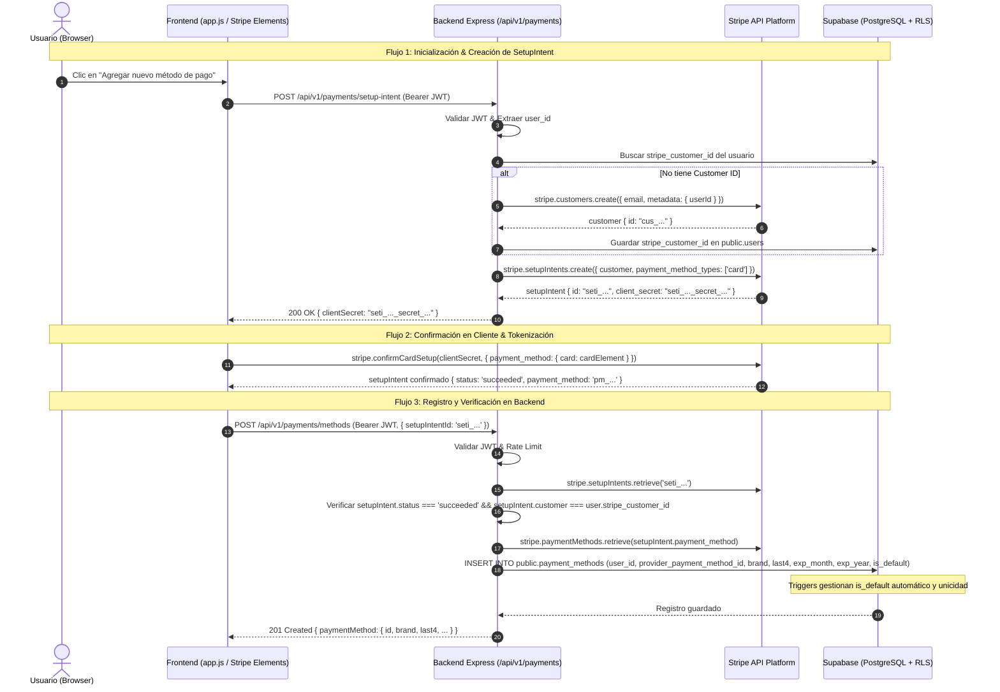

# Especificación de Arquitectura y Contrato de API: Módulo de Métodos de Pago
**Sistema:** BusTrack Pro  
**Módulo:** Gestión de Métodos de Pago (Stripe & Supabase)  
**Versión:** 1.0.0  
**Fecha:** 23 de Noviembre, 2026  
**Autor:** Subagente 1 — Arquitecto y Especialista en Seguridad  
**Destinatarios:** Subagente 2 (Backend), Subagente 3 (Frontend), Subagente 4 (QA / Security)

---

## 1. Visión General de la Arquitectura & Cumplimiento PCI-DSS

El módulo de **Métodos de Pago** de BusTrack Pro permite a los usuarios pasajeros y administradores registrar, visualizar, establecer como predeterminado y eliminar tarjetas de crédito/débito de forma 100% segura.

### Postura de Seguridad y Alcance PCI-DSS (SAQ A)
- **Cero exposición de datos sensibles**: Ni el frontend ni los servidores de BusTrack Pro reciben, procesan ni almacenan números de tarjeta completos (PAN), códigos de seguridad (CVV/CVC) o fechas de caducidad completas no tokenizadas.
- **Stripe Elements & SetupIntent**: La captura y tokenización se delegan exclusivamente a los iframes y bibliotecas de Stripe Elements alojadas por Stripe en el cliente.
- **Tokens de Proveedor**: BusTrack Pro únicamente almacena el identificador opaco generado por Stripe (`provider_payment_method_id`, ej. `pm_1Ox...`) junto con metadatos no sensibles (`brand`, `last4`, `exp_month`, `exp_year`).
- **Nivel de cumplimiento**: El sistema califica bajo **PCI-DSS SAQ A** (Self-Assessment Questionnaire A), reduciendo drásticamente el riesgo de brechas de datos y responsabilidad regulatoria.



---

## 2. Esquema de Base de Datos y Políticas RLS

### 2.1 Tabla `public.payment_methods` (PostgreSQL / Supabase)

La migración canónica se encuentra ubicada en:  
`server/database/migrations/20261123_payment_methods.sql`

```sql
-- Extensión requerida
CREATE EXTENSION IF NOT EXISTS "uuid-ossp";
CREATE EXTENSION IF NOT EXISTS "pgcrypto";

-- Columna stripe_customer_id en public.users
DO $$ 
BEGIN
    IF NOT EXISTS (
        SELECT 1 FROM information_schema.columns 
        WHERE table_schema = 'public' 
          AND table_name = 'users' 
          AND column_name = 'stripe_customer_id'
    ) THEN
        ALTER TABLE public.users ADD COLUMN stripe_customer_id TEXT UNIQUE;
        CREATE INDEX IF NOT EXISTS idx_users_stripe_customer_id ON public.users(stripe_customer_id);
    END IF;
END $$;

-- Tabla de métodos de pago
CREATE TABLE IF NOT EXISTS public.payment_methods (
    id UUID PRIMARY KEY DEFAULT gen_random_uuid(),
    user_id UUID NOT NULL REFERENCES auth.users(id) ON DELETE CASCADE,
    provider TEXT NOT NULL DEFAULT 'stripe',
    provider_payment_method_id TEXT NOT NULL UNIQUE,
    brand TEXT NOT NULL,
    last4 VARCHAR(4) NOT NULL,
    exp_month INT NOT NULL CHECK (exp_month BETWEEN 1 AND 12),
    exp_year INT NOT NULL CHECK (exp_year >= 2024),
    is_default BOOLEAN NOT NULL DEFAULT FALSE,
    created_at TIMESTAMPTZ NOT NULL DEFAULT timezone('utc'::text, now()),
    updated_at TIMESTAMPTZ NOT NULL DEFAULT timezone('utc'::text, now()),

    CONSTRAINT chk_last4_digits CHECK (last4 ~ '^[0-9]{4}$'),
    CONSTRAINT chk_provider_valid CHECK (provider IN ('stripe', 'sinpe_movil', 'cash_card'))
);

-- Índices de consulta rápida
CREATE INDEX IF NOT EXISTS idx_payment_methods_user_id ON public.payment_methods (user_id);
CREATE INDEX IF NOT EXISTS idx_payment_methods_provider_pm_id ON public.payment_methods (provider_payment_method_id);

-- Restricción ÚNICA: Solo 1 método predeterminado por usuario
CREATE UNIQUE INDEX IF NOT EXISTS idx_payment_methods_unique_default 
    ON public.payment_methods (user_id) 
    WHERE is_default = TRUE;
```

### 2.2 Funciones y Triggers de Autonomía de Datos

1. **Trigger de actualización de marca de tiempo (`updated_at`)**:
   Garantiza que cualquier modificación en la fila actualice `updated_at` sin intervención del cliente.
2. **Trigger de gestión de método predeterminado (`is_default`)**:
   - **Regla del primer método**: Si el usuario no tiene métodos de pago previos registrados, el nuevo método se marca forzosamente como `is_default = TRUE`.
   - **Regla de alternancia única**: Si un método se inserta o actualiza como `is_default = TRUE`, automáticamente se desmarcan (`is_default = FALSE`) todos los demás métodos pertenecientes a ese usuario.
3. **Trigger posterior a eliminación (`handle_payment_method_deletion_default`)**:
   - Si se elimina el método de pago que era predeterminado, el trigger promueve automáticamente al método más reciente restante del usuario como `is_default = TRUE`.

### 2.3 Políticas de Row Level Security (RLS)

```sql
ALTER TABLE public.payment_methods ENABLE ROW LEVEL SECURITY;

-- 1. SELECT: Cada usuario solo puede ver sus métodos de pago
CREATE POLICY "payment_methods_select_own" 
    ON public.payment_methods 
    FOR SELECT 
    TO authenticated 
    USING (auth.uid() = user_id);

-- 2. INSERT: Cada usuario solo puede registrar métodos para sí mismo
CREATE POLICY "payment_methods_insert_own" 
    ON public.payment_methods 
    FOR INSERT 
    TO authenticated 
    WITH CHECK (auth.uid() = user_id);

-- 3. UPDATE: Cada usuario solo puede modificar sus métodos
CREATE POLICY "payment_methods_update_own" 
    ON public.payment_methods 
    FOR UPDATE 
    TO authenticated 
    USING (auth.uid() = user_id)
    WITH CHECK (auth.uid() = user_id);

-- 4. DELETE: Cada usuario solo puede borrar sus propios métodos
CREATE POLICY "payment_methods_delete_own" 
    ON public.payment_methods 
    FOR DELETE 
    TO authenticated 
    USING (auth.uid() = user_id);
```

### 2.4 Compatibilidad con Entorno Local SQLite
Para pruebas automatizadas locales y entornos sin conexión activa a Supabase, se implementó el esquema equivalente en:  
`server/database/migrations/20261123_payment_methods.sqlite.sql`  
Utiliza `PRAGMA foreign_keys = ON;`, tipos afines a SQLite y un índice parcial único `WHERE is_default = 1`.

---

## 3. Flujo Completo de Integración con Stripe

### Paso 1: Configuración de Variables de Entorno y Clientes
En `.env`:
```ini
# Stripe Secrets
STRIPE_SECRET_KEY=sk_test_51...
STRIPE_PUBLISHABLE_KEY=pk_test_51...
STRIPE_WEBHOOK_SECRET=whsec_...
```
En el frontend (cliente web/móvil):
- Solo tiene acceso a `STRIPE_PUBLISHABLE_KEY`.
- Se inicializa `const stripe = Stripe(window.STRIPE_PUBLISHABLE_KEY);`.

### Paso 2: Creación de Customer & SetupIntent
1. Cliente envía `POST /api/v1/payments/setup-intent`.
2. Servidor verifica el token JWT y extrae `userId` y `email`.
3. Servidor busca `stripe_customer_id` en `public.users`:
   - Si no existe: invoca `stripe.customers.create({ email, metadata: { busTrackUserId: userId } })` y actualiza `public.users.stripe_customer_id`.
4. Servidor crea el SetupIntent:
   ```javascript
   const setupIntent = await stripe.setupIntents.create({
     customer: stripeCustomerId,
     payment_method_types: ['card'],
     usage: 'off_session', // Permite cobros futuros automáticos de pasajes
     metadata: { userId }
   });
   ```
5. Servidor responde `{ clientSecret: setupIntent.client_secret }`.

### Paso 3: Confirmación en Cliente con Stripe Elements
1. Frontend monta el contenedor `#card-element` o `PaymentElement`.
2. Al enviar el formulario, ejecuta:
   ```javascript
   const { setupIntent, error } = await stripe.confirmCardSetup(clientSecret, {
     payment_method: {
       card: elements.getElement('card'),
       billing_details: { name: userName }
     }
   });
   ```
3. Si `error`, se despliega mensaje amigable sin tocar el backend.
4. Si `setupIntent.status === 'succeeded'`, se procede al Paso 4.

### Paso 4: Notificación y Guardado Seguro en Backend
1. Frontend llama a `POST /api/v1/payments/methods` con `{ setupIntentId: setupIntent.id }`.
2. El backend **no confía en los parámetros enviados por el cliente**:
   - Recupera el SetupIntent directamente desde Stripe: `stripe.setupIntents.retrieve(setupIntentId)`.
   - Verifica que `setupIntent.status === 'succeeded'`.
   - Verifica que `setupIntent.customer === user.stripe_customer_id` (previene reutilización o suplantación).
3. Backend obtiene el PaymentMethod: `stripe.paymentMethods.retrieve(setupIntent.payment_method)`.
4. Extrae de forma segura:
   - `brand = paymentMethod.card.brand` (ej. `'visa'`)
   - `last4 = paymentMethod.card.last4` (ej. `'4242'`)
   - `exp_month = paymentMethod.card.exp_month`
   - `exp_year = paymentMethod.card.exp_year`
   - `provider_payment_method_id = paymentMethod.id`
5. Inserta en `public.payment_methods`. El trigger de base de datos determina si es el primer método y activa `is_default = true`.
6. Retorna `201 Created` con el objeto del método de pago sanitizado.

### Paso 5: Listar Métodos del Usuario
- `GET /api/v1/payments/methods`: Retorna los métodos del usuario autenticado ordenados por `is_default DESC, created_at DESC`.

### Paso 6: Establecer Método como Predeterminado
1. `PUT /api/v1/payments/methods/:id/default`
2. Backend verifica que el método pertenezca a `req.user.id`.
3. Actualiza `is_default = TRUE` en `public.payment_methods` (el trigger desmarca los demás).
4. Sincroniza con Stripe:
   ```javascript
   await stripe.customers.update(user.stripe_customer_id, {
     invoice_settings: { default_payment_method: pm.provider_payment_method_id }
   });
   ```

### Paso 7: Eliminar Método
1. `DELETE /api/v1/payments/methods/:id`
2. Backend valida pertenencia al usuario.
3. Desvincula el método en Stripe: `await stripe.paymentMethods.detach(pm.provider_payment_method_id)`.
4. Elimina la fila de `public.payment_methods`. Si era el método predeterminado, el trigger promueve automáticamente al siguiente disponible.

### Paso 8: Webhook de Stripe
- Endpoint expuesto: `POST /api/v1/payments/webhook`.
- Valida la firma del payload con `stripe.webhooks.constructEvent(req.rawBody, sig, webhookSecret)`.
- Eventos soportados:
  - `payment_method.detached`: Si un método es desvinculado desde el dashboard de Stripe, se elimina o inactiva en Supabase.
  - `setup_intent.succeeded`: Registro de auditoría o fallback de sincronización.
  - `customer.deleted`: Limpieza de registros asociados.

---

## 4. Contrato de API Formal (REST & Problem Details RFC 7807)

Todos los endpoints residen bajo el prefijo: `/api/v1/payments`.

### Formato Estándar de Error (RFC 7807 Problem Details)
Todas las respuestas de error siguen estrictamente el estándar del proyecto:
```json
{
  "type": "https://bustrackpro.com/errors/{error-code}",
  "title": "{Short human-readable summary}",
  "status": 400,
  "detail": "{Detailed context-specific error explanation}",
  "instance": "/api/v1/payments/methods"
}
```

---

### Endpoint 1: Crear SetupIntent
- **Método**: `POST`
- **URL**: `/api/v1/payments/setup-intent`
- **Headers Obligatorios**:
  - `Authorization: Bearer <JWT>`
  - `Content-Type: application/json`
- **Request Body**: `{}` (Vacío o metadatos opcionales)
- **Respuestas**:
  - `200 OK`:
    ```json
    {
      "success": true,
      "clientSecret": "seti_1OxABC12345_secret_XYZ98765",
      "customerId": "cus_N9Xy8aBcDeFgHi"
    }
    ```
  - `401 Unauthorized`: Token ausente o expirado.
  - `429 Too Many Requests`: Excedido límite de peticiones (Rate Limit).
  - `500 Internal Server Error`: Fallo de conexión con Stripe.

---

### Endpoint 2: Listar Métodos de Pago
- **Método**: `GET`
- **URL**: `/api/v1/payments/methods`
- **Headers Obligatorios**:
  - `Authorization: Bearer <JWT>`
- **Query Params**: Ninguno
- **Respuestas**:
  - `200 OK`:
    ```json
    {
      "success": true,
      "data": [
        {
          "id": "e8d35f49-5f12-4e4b-97e3-0d7bfb1d8e12",
          "provider": "stripe",
          "brand": "visa",
          "last4": "4242",
          "expMonth": 12,
          "expYear": 2028,
          "isDefault": true,
          "createdAt": "2026-11-23T10:00:00.000Z"
        },
        {
          "id": "1b490412-2598-466d-8e42-7a544c660c91",
          "provider": "stripe",
          "brand": "mastercard",
          "last4": "8888",
          "expMonth": 8,
          "expYear": 2027,
          "isDefault": false,
          "createdAt": "2026-11-20T14:30:00.000Z"
        }
      ]
    }
    ```
  - `401 Unauthorized`: No autenticado.

---

### Endpoint 3: Confirmar y Guardar Método de Pago
- **Método**: `POST`
- **URL**: `/api/v1/payments/methods`
- **Headers Obligatorios**:
  - `Authorization: Bearer <JWT>`
  - `Content-Type: application/json`
- **Request Body**:
  ```json
  {
    "setupIntentId": "seti_1OxABC12345",
    "makeDefault": false
  }
  ```
  *Validaciones*:
  - `setupIntentId`: String requerido, formato regex `^seti_[a-zA-Z0-9_]+$`.
  - `makeDefault`: Boolean opcional (default `false`).
- **Respuestas**:
  - `201 Created`:
    ```json
    {
      "success": true,
      "message": "Método de pago guardado correctamente.",
      "data": {
        "id": "e8d35f49-5f12-4e4b-97e3-0d7bfb1d8e12",
        "provider": "stripe",
        "brand": "visa",
        "last4": "4242",
        "expMonth": 12,
        "expYear": 2028,
        "isDefault": true,
        "createdAt": "2026-11-23T10:00:00.000Z"
      }
    }
    ```
  - `400 Bad Request`: `setupIntentId` no provisto, inválido o el SetupIntent aún no ha tenido éxito en Stripe (`status != 'succeeded'`).
  - `403 Forbidden`: El SetupIntent pertenece a un Stripe Customer distinto al del usuario autenticado (prevención de usurpación).
  - `409 Conflict`: El método de pago ya se encuentra registrado para este usuario.
  - `401 Unauthorized`: Token ausente o inválido.

---

### Endpoint 4: Establecer Método como Predeterminado
- **Método**: `PUT`
- **URL**: `/api/v1/payments/methods/:id/default`
- **Path Parameter**:
  - `id`: UUID del registro en `public.payment_methods`.
- **Headers Obligatorios**:
  - `Authorization: Bearer <JWT>`
- **Request Body**: Ninguno
- **Respuestas**:
  - `200 OK`:
    ```json
    {
      "success": true,
      "message": "Método de pago establecido como predeterminado.",
      "data": {
        "id": "1b490412-2598-466d-8e42-7a544c660c91",
        "isDefault": true,
        "updatedAt": "2026-11-23T10:05:00.000Z"
      }
    }
    ```
  - `401 Unauthorized`: No autenticado.
  - `404 Not Found`: Método de pago no existe o no pertenece al usuario autenticado (IDOR prevention).
  - `500 Internal Server Error`: Fallo al actualizar Stripe o base de datos.

---

### Endpoint 5: Eliminar Método de Pago
- **Método**: `DELETE`
- **URL**: `/api/v1/payments/methods/:id`
- **Path Parameter**:
  - `id`: UUID del registro en `public.payment_methods`.
- **Headers Obligatorios**:
  - `Authorization: Bearer <JWT>`
- **Request Body**: Ninguno
- **Respuestas**:
  - `200 OK`:
    ```json
    {
      "success": true,
      "message": "Método de pago eliminado y desvinculado exitosamente.",
      "data": {
        "id": "1b490412-2598-466d-8e42-7a544c660c91",
        "detachedFromProvider": true
      }
    }
    ```
  - `401 Unauthorized`: No autenticado.
  - `404 Not Found`: Método de pago no existe o no pertenece al usuario (IDOR).
  - `500 Internal Server Error`: Error al desvincular en Stripe.

---

### Endpoint 6: Webhook de Notificaciones de Stripe
- **Método**: `POST`
- **URL**: `/api/v1/payments/webhook`
- **Headers Obligatorios**:
  - `stripe-signature: t=...,v1=...`
- **Request Body**: Raw JSON payload (Buffer sin parsear por `express.json()`).
- **Respuestas**:
  - `200 OK`: `{"received": true}`
  - `400 Bad Request`: Firma de webhook inválida (`StripeSignatureVerificationError`).

---

## 5. Reglas Estrictas de Seguridad y Control de Acceso

1. **Inviolabilidad de Datos Sensibles**:
   - Está prohibido registrar o incluir en logs campos como `number`, `cvc`, `cvv`, `pan`, `pin`.
   - Si se inspecciona una excepción, sanitizar cualquier campo de respuesta de error de Stripe antes de loguear con `logger.js`.
2. **Validación Criptográfica de JWT**:
   - Todos los endpoints protegidos aplican el middleware `authenticateToken`.
   - Se valida la firma con `JWT_SECRET` o contra el endpoint `auth.getUser(token)` de Supabase.
3. **Prevención Estricta de IDOR (Insecure Direct Object Reference)**:
   - Toda consulta SQL hacia `payment_methods` debe incluir la cláusula obligatoria `WHERE user_id = req.user.id AND id = :id`.
   - Si la consulta retorna 0 filas, se responde `404 Not Found` en lugar de confirmar la existencia de un recurso de otro usuario.
   - En Supabase, RLS garantiza una segunda capa a nivel de base de datos impidiendo cualquier lectura/escritura cruzada.
4. **Verificación Cruzada de Customer ID**:
   - En `POST /api/v1/payments/methods`, el servidor compara obligatoriamente `setupIntent.customer === user.stripe_customer_id`. Si un atacante intenta registrar un `setupIntentId` ajeno o huérfano, la petición es rechazada con `403 Forbidden`.
5. **Mitigación de Ataques de Fuerza Bruta y Pruebas de Tarjetas (Card Testing)**:
   - Se aplica `rateLimiter` estricto en `/setup-intent` y `/methods` (máximo 10 peticiones por minuto por usuario/IP).
6. **Validación de Webhook con Secreto de Firma**:
   - El webhook rechaza cualquier mensaje que no posea una firma válida emitida con `STRIPE_WEBHOOK_SECRET` dentro de una tolerancia de 300 segundos (previene ataques de replay).

---

## 6. Guía de Ejecución para Subagentes

### Para Subagente 2 (Especialista en Backend y Rutas Express):
- Crear `server/services/paymentService.js` con las operaciones de Stripe y Supabase/SQLite.
- Crear `server/routes/paymentRoutes.js` e integrarlo en `server/routes/api.js` (`apiRouter.use('/payments', paymentRouter)`).
- Importar y usar `stripe` SDK (`npm install stripe` o mock si offline).
- Añadir middleware `express.raw({ type: 'application/json' })` específicamente antes del parser JSON global para la ruta `/webhook`.

### Para Subagente 3 (Especialista en Frontend y UI):
- Añadir sección o modal "Métodos de Pago" en el dashboard del pasajero / perfil (`index.html` y `app.js`).
- Cargar `https://js.stripe.com/v3/` de forma asíncrona y segura.
- Mostrar lista de tarjetas con insignias para la tarjeta predeterminada, logos de franquicias (Visa, Mastercard, AMEX) y fecha de expiración `MM/YYYY`.
- Proporcionar botones accesibles para: "Establecer como Predeterminada" y "Eliminar".

### Para Subagente 4 (QA y Seguridad):
- Crear suite de pruebas de integración en `test/payments.test.js`.
- Comprobar que intentos de IDOR (usuario A intentando modificar o borrar método de usuario B) devuelven `404 Not Found`.
- Probar que un método nuevo sin otros existentes queda automáticamente marcado como predeterminado (`is_default = true`).
- Probar que al marcar un nuevo predeterminado, el anterior se desmarca correctamente.
